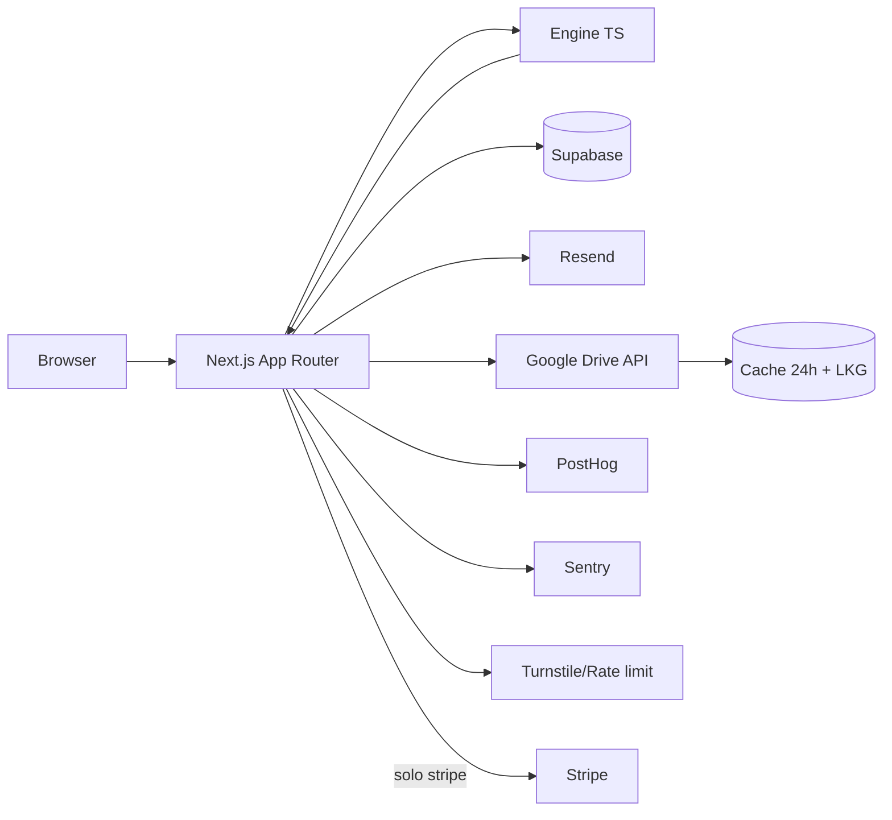

# PRD — ChronoSleep
**Versión del paquete:** 4.0  
**Estado:** READY_TO_BUILD  
**Fecha:** 2026-10-05  
**Owner del documento:** Product / Engineering  
**Fuente de verdad técnica:** este PRD + `spec/` + `ux/` + `model/`  
**Naturaleza del producto:** bienestar y planificación educativa para adultos 18+; no diagnóstico ni tratamiento.

## 0. Ficha y versión
- **App:** ChronoSleep (`chronosleep`).
- **Modelo:** `chronosleep-sjl-2.0`.
- **Stage previo:** Etapa 3 con QA `PASS_WITH_FIXES`, 21/21 vectores verificados y 0 bloqueadores críticos.
- **Stage actual:** 4, paquete build v4.
- **Modo inicial:** `MONETIZATION_MODE=validation`.
- **Deploy objetivo:** GitHub + Vercel; Netlify es alternativa soportada.
- **Idiomas:** español, inglés y portugués.
- **Gate no técnico:** confirmar titularidad/clearance del nombre ChronoSleep y del dominio antes de go-live.
- **Decisión de alcance:** el “predictor” del MVP es una simulación determinista de calendario bajo adherencia, no una predicción fisiológica.

## 1. Resumen ejecutivo
ChronoSleep cuantifica la diferencia entre el punto medio de sueño de días con obligaciones y días libres (“social jetlag”) con ocho inputs que el usuario conoce, sin wearable. Entrega gratis la cifra principal y una visual comprensible; el informe completo agrega plan simulado de 7 días, escenarios de flexibilidad, sensibilidad, metodología y exportación.

La oportunidad es ofrecer una herramienta web rápida y auditable entre calculadoras genéricas gratuitas y apps de seguimiento por suscripción. El motor es determinista, está doblemente verificado y no necesita LLM. El objetivo de la primera versión es validar demanda: al menos 30% de preview→email y señal de pago >=8% durante 2 semanas o >=200 previews, sin deteriorar completitud. Una señal adicional fuerte es >=50 solicitudes de informe en 14 días.

## 2. Problema y evidencia
El problema principal no es “diagnosticar sueño”, sino hacer visible un desajuste de horario que el usuario experimenta pero rara vez cuantifica. El brief de Etapa 3 documenta que 46.5% de adultos de EE. UU. en NHANES 2017–2020 tenían >=1 h de social jetlag y 19.3% >=2 h; estas cifras son referencia poblacional, no prevalencia universal ni umbrales clínicos. También documenta demanda de búsquedas utilitarias relacionadas con calculadoras y horarios de sueño. Ver `docs/brief_estrategico.md` y `source_stage3/APP-chronosleep/01_estrategia/fuentes_mercado.csv`.

Evidencia técnica: `model/engine_reference.py` y `model/qa_engine.py` coinciden con los 21 vectores oficiales a tolerancia 1e-6. El MVP por tanto no necesita entrenamiento para entregar su promesa central.

## 3. Mercado y segmentos
**Segmento primario:** profesionales y estudiantes adultos con horarios sociales impuestos y diferencia perceptible entre semana y días libres. **Top-of-funnel:** personas que buscan “sleep calculator”, “sleep schedule” o “chronotype” y quieren una respuesta inmediata. **V2:** turnos rotativos/nocturnos y uso recurrente, porque el modelo actual supone un patrón semanal simple.

Mercados iniciales de contenido/precio según el brief: EE. UU., Brasil, Reino Unido, Canadá, Australia, México y España. El orden no implica lanzamiento simultáneo. Las cifras de mercado y SEO son señales preliminares y deben revalidarse antes de paid acquisition.

## 4. Persona y JTBD
**Persona primaria — Alex, 28–42, trabajador/a o estudiante adulto/a:** tiene obligaciones fijas entre semana, duerme distinto los días libres, no quiere llevar un wearable ni mantener una app de tracking y busca una respuesta accionable en menos de dos minutos.

**JTBD principal:** “Cuando mi horario cambia entre días de obligación y días libres, quiero saber cuánto cambia realmente y qué horario semanal sería factible dentro de mi flexibilidad, para poder tomar una decisión sin tener que trackearme durante semanas.”

**Ansiedades:** que el resultado sea pseudocientífico, que la app venda un diagnóstico, que pida demasiados datos y que el informe o email terminen compartiendo horarios sin permiso.

## 5. Competencia
El brief compara RISE, Sleep Cycle y ShutEye (tracking/suscripción), Stellar Sleep (programa clínico/alto ticket), SleepDoctor Chronotype Quiz (clasificación gratuita) y SleepCalculator.com (calculadora SEO). ChronoSleep se diferencia por: 2 minutos, sin wearable, social jetlag en horas/minutos, simulación semanal reproducible, precio one-off futuro y metodología visible. No competir con claims clínicos ni con features de tracking nocturno en MVP.

## 6. Propuesta de valor
**ES:** “Entiende tu desfase. Alinea tu semana.”  
**EN:** “See your schedule gap. Align your week.”  
**PT:** “Entenda seu descompasso. Alinhe sua semana.”

Promesa operativa: cuantificar el desfase de horarios y explorar una simulación semanal que respeta la flexibilidad declarada. Nunca prometer “corregir el reloj biológico”, predecir DLMO, diagnosticar insomnio ni recomendar fármacos/suplementos.

## 7. Alcance MVP, fuera de alcance y V2
**MVP:** landing, wizard de 8 inputs, validación, cálculo, preview gratuito, email gate, generación de informe HTML/PDF, flujo validation al owner, `/admin`, i18n ES/EN/PT, analítica, Drive con checksum/fallback, seguridad, CI/CD y Stripe detrás de feature flag.

**Fuera de alcance:** diagnóstico/tratamiento, melatonina o dosis, wearables, turnos rotativos complejos, chatbot clínico, entrenamiento ML, cuentas de usuario públicas, suscripción activa y recomendación de “ciclo perfecto” de 90 minutos.

**V2:** calendario real/turnos, wearables, regularidad longitudinal, replanificación recurrente, suscripción y B2B2C tras validación legal y de utilidad.

## 8. Flujo end-to-end
```mermaid
flowchart TD
  A[Landing] --> B[Wizard 1..8]
  B --> C{Validación schema + 3-14 h}
  C -->|error| B
  C -->|válido| D[Motor TypeScript]
  D --> E[Preview gratis]
  E --> F{MONETIZATION_MODE}
  F -->|validation| G[Email + consentimientos]
  G --> H[Guardar lead + generar PDF]
  H --> I[Confirmación usuario]
  H --> J[Email OWNER_EMAIL + PDF]
  J --> K[/admin approve o resend]
  F -->|stripe| L[Stripe Checkout]
  L --> M[Webhook firmado e idempotente]
  M --> N[Entrega automática informe]
  H --> O[Informe web protegido]
  N --> O
  O --> P[PDF / ICS]
```
Los flujos UX detallados se mantienen en `ux/sitemap_flows.md`.

## 9. Historias de usuario US-xx con Gherkin

### US-01
Como visitante, quiero entender la propuesta y empezar el cálculo sin crear cuenta.

```gherkin
Feature: US-01
  Scenario: camino principal de US-01
    Given la app está configurada según este PRD
    When el usuario ejecuta el flujo de US-01
    Then el resultado cumple los FR trazados a US-01 y no expone datos fuera de su consentimiento
```

### US-02
Como usuario, quiero ingresar mis 8 datos de horarios en pasos simples y reversibles.

```gherkin
Feature: US-02
  Scenario: camino principal de US-02
    Given la app está configurada según este PRD
    When el usuario ejecuta el flujo de US-02
    Then el resultado cumple los FR trazados a US-02 y no expone datos fuera de su consentimiento
```

### US-03
Como usuario, quiero que la app rechace horarios o valores fuera del contrato antes de calcular.

```gherkin
Feature: US-03
  Scenario: camino principal de US-03
    Given la app está configurada según este PRD
    When el usuario ejecuta el flujo de US-03
    Then el resultado cumple los FR trazados a US-03 y no expone datos fuera de su consentimiento
```

### US-04
Como usuario, quiero ver gratis mi social jetlag, una visual y una explicación no clínica.

```gherkin
Feature: US-04
  Scenario: camino principal de US-04
    Given la app está configurada según este PRD
    When el usuario ejecuta el flujo de US-04
    Then el resultado cumple los FR trazados a US-04 y no expone datos fuera de su consentimiento
```

### US-05
Como usuario interesado, quiero solicitar el informe completo con mi email y consentimiento explícito.

```gherkin
Feature: US-05
  Scenario: camino principal de US-05
    Given la app está configurada según este PRD
    When el usuario ejecuta el flujo de US-05
    Then el resultado cumple los FR trazados a US-05 y no expone datos fuera de su consentimiento
```

### US-06
Como propietario, quiero recibir una solicitud con resultados y PDF para revisar o aprobar su envío.

```gherkin
Feature: US-06
  Scenario: camino principal de US-06
    Given la app está configurada según este PRD
    When el usuario ejecuta el flujo de US-06
    Then el resultado cumple los FR trazados a US-06 y no expone datos fuera de su consentimiento
```

### US-07
Como usuario autorizado, quiero abrir y descargar un informe completo coherente con el motor.

```gherkin
Feature: US-07
  Scenario: camino principal de US-07
    Given la app está configurada según este PRD
    When el usuario ejecuta el flujo de US-07
    Then el resultado cumple los FR trazados a US-07 y no expone datos fuera de su consentimiento
```

### US-08
Como usuario ES/EN/PT, quiero usar la app y recibir comunicaciones en mi idioma.

```gherkin
Feature: US-08
  Scenario: camino principal de US-08
    Given la app está configurada según este PRD
    When el usuario ejecuta el flujo de US-08
    Then el resultado cumple los FR trazados a US-08 y no expone datos fuera de su consentimiento
```

### US-09
Como titular de datos, quiero ejercer acceso, corrección o eliminación sin exponer más datos de los necesarios.

```gherkin
Feature: US-09
  Scenario: camino principal de US-09
    Given la app está configurada según este PRD
    When el usuario ejecuta el flujo de US-09
    Then el resultado cumple los FR trazados a US-09 y no expone datos fuera de su consentimiento
```

### US-10
Como administrador, quiero ver leads, embudo y reintentar entregas desde /admin.

```gherkin
Feature: US-10
  Scenario: camino principal de US-10
    Given la app está configurada según este PRD
    When el usuario ejecuta el flujo de US-10
    Then el resultado cumple los FR trazados a US-10 y no expone datos fuera de su consentimiento
```

### US-11
Como operador, quiero que los archivos de Drive se validen, cacheen 24 h y tengan fallback a la última versión válida.

```gherkin
Feature: US-11
  Scenario: camino principal de US-11
    Given la app está configurada según este PRD
    When el usuario ejecuta el flujo de US-11
    Then el resultado cumple los FR trazados a US-11 y no expone datos fuera de su consentimiento
```

### US-12
Como comprador, cuando el cobro esté habilitado quiero pagar y recibir el informe automáticamente una sola vez.

```gherkin
Feature: US-12
  Scenario: camino principal de US-12
    Given la app está configurada según este PRD
    When el usuario ejecuta el flujo de US-12
    Then el resultado cumple los FR trazados a US-12 y no expone datos fuera de su consentimiento
```

### US-13
Como usuario que llega por buscador, quiero páginas públicas útiles e indexables sin que mis resultados se indexen.

```gherkin
Feature: US-13
  Scenario: camino principal de US-13
    Given la app está configurada según este PRD
    When el usuario ejecuta el flujo de US-13
    Then el resultado cumple los FR trazados a US-13 y no expone datos fuera de su consentimiento
```

### US-14
Como usuario con necesidades de accesibilidad, quiero completar todo el flujo por teclado, lector y reduced motion.

```gherkin
Feature: US-14
  Scenario: camino principal de US-14
    Given la app está configurada según este PRD
    When el usuario ejecuta el flujo de US-14
    Then el resultado cumple los FR trazados a US-14 y no expone datos fuera de su consentimiento
```

## 10. Requisitos FR-xx y NFR-xx

### Requisitos funcionales
- **FR-01** (US-01, AT-01): Landing pública con propuesta, confianza, CTA único y disclaimer wellness.
- **FR-02** (US-02, AT-02): Wizard de 8 pasos, un input principal por pantalla, con persistencia de sesión y navegación atrás.
- **FR-03** (US-03, AT-03): Validar inputs contra `spec/inputs.schema.json` y reglas 3–14 h antes de invocar el motor.
- **FR-04** (US-03, AT-04): Portar `model/engine_reference.py` a TypeScript sin cambiar semántica y pasar 21/21 vectores.
- **FR-05** (US-04, AT-05): Renderizar vista previa con `social_jetlag_hours`, `weekly_timing_chart` y `one_insight`.
- **FR-06** (US-04, AT-06): Mostrar sensibilidad, referencia poblacional y disclaimers sin lenguaje diagnóstico.
- **FR-07** (US-05, AT-07): Formulario de solicitud con email, consentimiento de envío requerido y copia al equipo opcional OFF.
- **FR-08** (US-05, AT-08): Crear cálculo/lead en Supabase por API server-side; no enviar email ni HH:MM exactos a analytics.
- **FR-09** (US-06, AT-09): Generar PDF completo al crear solicitud en modo validation.
- **FR-10** (US-06, AT-10): Enviar confirmación al usuario y email a OWNER_EMAIL con asunto `[ChronoSleep] Solicitud de informe <id>`.
- **FR-11** (US-06, AT-11): Adjuntar o enlazar de forma privada el PDF al owner y solo incluir inputs/resultados en copia al equipo cuando exista opt-in específico.
- **FR-12** (US-07, AT-12): Proteger `/informe/:id` con token opaco/expirable y evitar PII en URL.
- **FR-13** (US-07, AT-13): El informe web/PDF debe contener todos los outputs de `spec/outputs_spec.json` para INFORME_COMPLETO.
- **FR-14** (US-07, AT-14): Permitir exportación ICS del plan de 7 días desde el informe completo.
- **FR-15** (US-08, AT-15): Localizar interfaz, emails y SEO en es/en/pt con next-intl y `spec/copy_i18n.json`.
- **FR-16** (US-09, AT-16): Exponer flujo de solicitud de derechos y borrado; ejecutar borrado de payload/email y registrar auditoría mínima no reversible.
- **FR-17** (US-10, AT-17): `/admin` autenticado para listar leads, estados, funnel y acciones approve/resend.
- **FR-18** (US-10, AT-18): `/admin` debe estar noindex y autorizado solo para ADMIN_EMAILS.
- **FR-19** (US-11, AT-19): Leer Drive desde GOOGLE_DRIVE_FOLDER_ID por ruta/nombre, verificar SHA-256 contra `spec/drive_manifest.json`.
- **FR-20** (US-11, AT-20): Cachear artefactos Drive 24 h y usar última versión válida si Drive falla o checksum no coincide.
- **FR-21** (US-11, AT-21): Implementar `npm run drive:sync` para subir `drive/` preservando subcarpetas.
- **FR-22** (US-12, AT-22): Con MONETIZATION_MODE=stripe crear Checkout Session con precio permitido y metadata mínima.
- **FR-23** (US-12, AT-23): Verificar firma Stripe, manejar webhook idempotente y entregar PDF automáticamente solo tras pago confirmado.
- **FR-24** (US-12, AT-24): Mantener Stripe inaccesible cuando MONETIZATION_MODE=validation.
- **FR-25** (US-13, AT-25): Implementar rutas públicas y noindex según `ux/sitemap_flows.md`, canonical y hreflang es/en/pt.
- **FR-26** (US-13, AT-26): Emitir WebApplication y FAQPage solo en páginas visibles compatibles; nunca indexar resultados/admin/checkout.
- **FR-27** (US-14, AT-27): Cumplir teclado, foco, labels, errores, targets >=44px y prefers-reduced-motion según `ux/ux_spec.md`.
- **FR-28** (US-14, AT-28): PDF debe ser semánticamente equivalente al informe web y comprensible sin depender del color.
- **FR-29** (US-01, AT-29): Instrumentar PostHog según `spec/analytics_events.json` con propiedades categorizadas y consentimiento aplicable.
- **FR-30** (US-10, AT-30): Instrumentar Sentry con redacción de PII y request IDs; no capturar inputs crudos ni emails.
- **FR-31** (US-05, AT-31): Aplicar Turnstile y rate limit en solicitud de informe; rate limit también en cálculo y endpoints de auth/admin.
- **FR-32** (US-07, AT-32): Generar PDF con @react-pdf/renderer siguiendo `ux/report_layout.md` y versión/ID en footer.
- **FR-33** (US-10, AT-33): Aplicar retención configurable: cálculos anónimos 30 días, leads/reportes 90 días por defecto, pedidos 7 años solo si obligación fiscal aplicable; política final debe validarse por mercado.
- **FR-34** (US-05, AT-34): Ofrecer waitlist de suscripción sin activar cobro recurrente en MVP.

### Requisitos no funcionales
- **NFR-01 — Performance:** p95 de Route Handlers de cálculo/lead <2 s; cálculo puro objetivo <100 ms en CI.
- **NFR-02 — Frontend:** Lighthouse móvil >=90 en Performance, Accessibility, Best Practices y SEO para landing y páginas públicas clave.
- **NFR-03 — Disponibilidad:** Fallback Drive a última versión válida; la calculadora no depende de Drive en cada request.
- **NFR-04 — Seguridad:** TypeScript strict, Zod/JSON Schema, CSP, headers seguros, secretos solo server-side, RLS en todas las tablas con PII.
- **NFR-05 — Privacidad:** Minimización, cifrado AES-256-GCM de email/inputs/resultados sensibles, redacción de logs, consentimiento granular y retención.
- **NFR-06 — Confiabilidad:** 21/21 vectores exactos a 1e-6 y tests de contrato en cada CI.
- **NFR-07 — Accesibilidad:** WCAG 2.2 AA para flujo principal y reporte; sin dependencia exclusiva de color.
- **NFR-08 — i18n:** es/en/pt completos; ninguna cadena crítica hardcodeada fuera del sistema i18n.
- **NFR-09 — Costo:** Costo variable objetivo por informe validation <=US$0.15 mediana y <=US$0.25 p95, excluyendo Stripe y adquisición; medir antes de activar paid acquisition.
- **NFR-10 — Observabilidad:** Sentry + métricas de entrega; alertar si fallos de cálculo >1% o entrega >2% en ventana de 30 min.
- **NFR-11 — SEO:** Core Web Vitals sin regresiones críticas y todas las rutas privadas/noindex fuera del sitemap.
- **NFR-12 — Portabilidad:** Deploy en Vercel por defecto y compatible con Netlify ajustando adaptador/cron sin cambiar contratos de dominio.

## 11. Inputs
El contrato de inputs **no se duplica** aquí. Fuente normativa: `spec/inputs.schema.json`; semántica y límites: `spec/model_spec.json`; interacción: `ux/ux_spec.md`. El frontend y API deben validar contra el mismo contrato. Son ocho campos: cuatro horas HH:MM, latencia 0–120 min, días laborales 1–6, alarma libre booleana y flexibilidad 0–120 min. Las duraciones implícitas fuera de 3–14 h se rechazan.

## 12. Modelo
La fórmula, aritmética circular, planner, supuestos, sensibilidad y rango de validez están en `spec/model_spec.json`. La implementación de referencia es `model/engine_reference.py`; `model/qa_engine.py` es verificación independiente. El programador debe portar el motor a TypeScript y demostrar paridad 21/21 con `spec/test_vectors.json` antes de conectar UI. No se permite introducir LLM en el cálculo.

## 13. Base de datos y Drive
El esquema completo está en `spec/db_schema.sql`; RLS debe permanecer activo en todas las tablas sensibles. Los payloads con email/horarios/resultados se cifran server-side con AES-256-GCM usando `DATA_ENCRYPTION_KEY_BASE64`; se guarda hash del email para deduplicación sin texto claro consultable.

Los artefactos de conocimiento/configuración que la app puede leer están en `drive/` y se inventarían por `spec/drive_manifest.json`. La app accede a la carpeta compartida definida por `GOOGLE_DRIVE_FOLDER_ID`, resuelve por nombre/ruta, verifica SHA-256, cachea 24 h y conserva la última versión válida. Si Drive falla o llega un archivo con checksum incorrecto, no debe reemplazar el cache válido. `npm run drive:sync` sube la carpeta `drive/`. Detalle operativo: `docs/DRIVE_SETUP.md`.

## 14. Outputs y niveles de acceso
La fuente normativa es `spec/outputs_spec.json`; no redefinir formatos en otro lugar. **Preview gratuito:** `social_jetlag_hours`, `weekly_timing_chart`, `one_insight`. **Informe completo:** `plan_7d`, `planned_social_jetlag_hours`, `scenario_no_flex`, `scenario_more_flex`, `input_sensitivity`, `msf_sc`, `population_reference`, `drivers`, `implementation_plan`, `methodology`, `social_jetlag_sleep_corrected_hours`. Suscripción V2 permanece deshabilitada.

## 15. UX/UI
No se duplica el diseño. Usar `ux/ux_spec.md`, `ux/components.md`, `ux/sitemap_flows.md`, `spec/design_tokens.json` y `spec/copy_i18n.json` como contratos. La UI debe conservar un input principal por paso incluso en desktop, valor antes del gate, una acción primaria por pantalla y timeline de 24 h en lugar de gauge clínico.

## 16. Informe PDF
La estructura normativa está en `ux/report_layout.md`. Generar con `@react-pdf/renderer`; 8–10 páginas adaptables, texto seleccionable cuando sea viable, caption/alternativa textual para gráficos, footer con modelo/ID/página y sin email en metadata. El informe web y PDF deben ser semánticamente equivalentes y obtener sus cifras del mismo objeto de dominio.

## 17. Monetización y tracción
`MONETIZATION_MODE=validation` es el default. En este modo el preview es gratis; “Recibe tu informe completo” pide email + consentimiento de envío, guarda lead, manda confirmación al usuario y notifica a `OWNER_EMAIL` con asunto `[ChronoSleep] Solicitud de informe <id>`, inputs/resultados permitidos y PDF completo. El opt-in de copia de datos al equipo es separado y OFF; si está OFF, el owner recibe el evento comercial y resumen no sensible necesario para gestionar la solicitud, pero no horarios crudos.

`MONETIZATION_MODE=stripe` activa Checkout, webhook firmado/idempotente y entrega automática. Los precios se leen de `spec/monetizacion.json`; son preliminares hasta elasticidad. Activar cobro cuando, durante al menos 2 semanas o >=200 previews, preview→email sea >=30%, señal de pago >=8% entre solicitantes y no caiga materialmente inicio→preview. Señal adicional fuerte: >=50 solicitudes en 14 días.

## 18. Emails
**Usuario — confirmación validation.** Asunto localizado: “Recibimos tu solicitud de informe ChronoSleep”. Contenido: ID opaco, qué ocurre después, recordatorio de que es información educativa y enlace a privacidad. No repetir horarios en texto del email.

**Owner — solicitud.** Asunto exacto: `[ChronoSleep] Solicitud de informe <id>`. Incluir locale, timestamps, resultados agregados y enlace admin. Adjuntar/enlazar PDF privado. Incluir inputs crudos solo cuando `consentimiento_copia_al_propietario` sea true.

**Stripe — entrega.** Tras webhook confirmado: asunto localizado “Tu informe ChronoSleep está listo”, enlace expirable al informe y PDF. Resend es el proveedor; DKIM/SPF/DMARC son gate de lanzamiento.

## 19. Arquitectura y stack
- Next.js App Router + TypeScript `strict`.
- Tailwind CSS + shadcn/ui.
- Route Handlers como API; sin FastAPI salvo que Python/ONNX se vuelva imprescindible (no lo es en MVP).
- Motor TypeScript portado 1:1 desde `model/engine_reference.py`.
- Supabase Postgres + RLS para cálculos, leads, entregas y pedidos; Supabase Auth para `/admin`; Storage privado opcional para PDFs.
- Google Drive API con service account, checksum, cache 24 h y last-known-good.
- Resend; `@react-pdf/renderer`; next-intl (es/en/pt); PostHog; Sentry; Turnstile; Upstash rate limit.
- Vitest + Playwright + test vectors; GitHub Actions.
- Stripe detrás de `MONETIZATION_MODE=stripe`.
- Vercel default; Netlify compatible.

### Diagrama de arquitectura


## 20. API (OpenAPI 3.1)
Contrato completo: `spec/openapi.yaml`. Rutas mínimas: `/api/calculate`, `/api/report-requests`, `/api/reports/{id}`, `/api/admin/leads`, `/api/admin/leads/{id}/approve`, `/api/admin/leads/{id}/resend`, `/api/checkout/session`, `/api/stripe/webhook`, `/api/privacy/requests`, `/api/health`. Todos los endpoints mutantes deben aceptar/crear request ID; Stripe usa idempotencia del proveedor y tabla local de eventos.

## 21. Modelo de datos con RLS
Contrato ejecutable: `spec/db_schema.sql`. Tablas: `calculations`, `leads`, `report_artifacts`, `deliveries`, `orders`, `webhook_events`, `privacy_requests`, `audit_log`. No hay acceso PostgREST anónimo a PII; el browser habla con Route Handlers. RLS permite lectura/acción admin a usuarios autenticados incluidos en `ADMIN_EMAILS`/claim equivalente; service role opera solo server-side.

## 22. Seguridad, privacidad y legal
Privacidad por diseño: minimización, finalidad, retención corta, consentimiento granular, cifrado, no PII en analytics/logs, token opaco de informe y verificación de permisos. Turnstile + rate limit protegen gates; CSP y headers reducen XSS/clickjacking; secretos no pueden aparecer en bundles cliente salvo claves públicas explícitas.

**GDPR (UE):** diseñar para información clara, acceso, rectificación, supresión, restricción/portabilidad/objeción donde aplique, base legal documentada y minimización. Fuente oficial consultada: https://commission.europa.eu/law/law-topic/data-protection/information-individuals_en y https://commission.europa.eu/law/law-topic/data-protection/data-protection-explained_en.

**CCPA/CPRA (California):** si la empresa entra en ámbito, publicar disclosures, soportar derechos aplicables y revisar obligaciones 2026 sobre risk assessments, cybersecurity audits y ADMT cuando correspondan. Fuente: https://cppa.ca.gov/ y regulaciones efectivas 2026. El motor actual no toma decisiones con efecto legal/significativo, pero debe revisarse si cambia el producto.

**LGPD (Brasil):** mapear finalidad/base legal, transparencia, seguridad y derechos de titulares bajo Lei 13.709/2018; revisar guías ANPD vigentes. Fuente oficial: https://www.planalto.gov.br/ccivil_03/_ato2015-2018/2018/lei/l13709.htm.

**Perú — Ley 29733:** el nuevo Reglamento aprobado por DS 016-2024-JUS está vigente desde 31/03/2025. Antes de operar como titular de un banco de datos en Perú, revisar y cumplir inscripción en el Registro Nacional cuando corresponda, consentimiento, información, seguridad y derechos. Fuentes: https://www.gob.pe/institucion/anpd/normas-legales/6554453-16-2024-jus y https://www.gob.pe/8060-inscribir-banco-de-datos-en-el-registro-nacional-de-proteccion-de-datos-personales.

Estas notas son requisitos de producto, no asesoría legal. Antes de lanzamiento en cada mercado: confirmar entidad controladora, base legal, DPA/subencargados, transferencias internacionales, retención, cookies/analytics y textos legales con counsel.

**Salud:** mantener categoría wellness/educativa; no diagnóstico, tratamiento o claims de biomarcador. No copiar el instrumento MCTQ oficial sin permiso. Clearance de marca/dominio es gate de go-live.

## 23. Accesibilidad e i18n
WCAG 2.2 AA: teclado completo, focus visible, labels y descripciones, errores asociados, `aria-live` en procesando, touch targets >=44 px, reduced motion y contraste documentado en tokens. Locales `es`, `en`, `pt`; formatos de hora se presentan en convención local sin cambiar el contrato HH:MM interno. El contenido legal/SEO debe tener equivalentes localizados, no traducciones parciales.

## 24. Analítica y KPIs
Implementar exactamente los eventos de `spec/analytics_events.json`. Nunca enviar email, horarios exactos o texto libre a PostHog. Funnels principales: visita→inicio >=35%, inicio→preview >=70%, preview→email >=30%, intención/pago >=8% entre solicitantes, mediana inicio→preview <=90 s. Guardar `experiment_ids` y locale solo cuando no permitan reidentificación.

Umbrales operativos: `calculation_failed_rate <1%`; `report_delivery_failure_rate <2%`; alertar por superación sostenida 30 min. Medir costo variable por informe y p95 de API.

## 25. SEO y adquisición
Indexables: landing, Cómo funciona, FAQ y páginas país/caso de uso compatibles con `ux/sitemap_flows.md`. Noindex: wizard, procesando, resultado, solicitud, checkout, informe individual y admin. Canonical + hreflang ES/EN/PT. No usar keywords médicas de tratamiento como gancho del MVP. Structured data solo si coincide con contenido visible.

Adquisición inicial: SEO long-tail, comunidades relevantes respetando sus normas, creadores de productividad/quantified-self/sueño y outreach editorial. Prohibido spamear comunidades o usar claims clínicos.

## 26. Plan de pruebas
Pirámide: unit tests de helpers y motor; contract tests contra JSON Schema/OpenAPI; 21 vectores oficiales; integración Supabase/Drive/Resend mockeados; Playwright de funnels validation y stripe; a11y con axe; Lighthouse CI; seguridad básica; pruebas de fallback Drive y webhook idempotente. Detalle ejecutable en `docs/ACCEPTANCE_TESTS.md`.

## 27. Despliegue y operación
Repo GitHub con CI obligatoria en PR. Preview deployments en Vercel; producción solo desde rama protegida. Variables se configuran desde `.env.example`. Cron diario: limpieza de retención y verificación Drive; cron horario opcional de entregas fallidas. Backups Supabase según plan; restore drill antes de paid launch.

Health check debe verificar app + DB, pero no fallar producción porque Drive esté temporalmente caído si existe last-known-good. Sentry no captura PII. Netlify puede sustituir Vercel manteniendo contratos y tareas.

## 28. Definition of Done
1. `npm ci`, lint, typecheck, unit, 21/21 vectors y Playwright pasan en CI.
2. Lighthouse móvil >=90 en cuatro categorías en páginas objetivo.
3. OpenAPI y DB schema aplicados sin divergencia.
4. `MONETIZATION_MODE=validation` funciona de punta a punta con correo real de prueba y PDF.
5. `/admin` lista lead y permite approve/resend.
6. Drive checksum/cache/fallback y `npm run drive:sync` verificados.
7. Ningún secreto/PII aparece en repo, logs o PostHog.
8. Locales ES/EN/PT completos.
9. PDF coincide con outputs y layout.
10. Legal/disclaimers publicados; marca/dominio y requisitos locales resueltos antes de go-live.
11. Sentry/PostHog operativos, alertas configuradas.
12. `docs/LAUNCH_CHECKLIST.md` completado.

## 29. Riesgos
- **Marca/dominio — Alto:** clearance pendiente; bloquear go-live, no build.
- **Sobreclaim de salud — Alto:** copy y review automatizado/manual; no DLMO/diagnóstico/tratamiento.
- **Datos personales/sueño — Alto:** cifrado, minimización, RLS, retención, DPA y derechos.
- **Autorreporte — Medio:** sensibilidad visible y piloto prospectivo; no presentar IC estadístico.
- **Willingness-to-pay — Medio-Alto:** validation antes de Stripe; no construir suscripción primero.
- **Dependencia Drive — Bajo/Medio:** cache 24 h + last-known-good.
- **Deliverability — Medio:** SPF/DKIM/DMARC, dominio verificado, bounce handling.
- **Drift motor TS — Alto:** vectors en CI y hash/version del modelo.

## 30. Supuestos
- Público 18+ y uso wellness.
- Un patrón simple de `workdays_per_week` seguido de días libres es suficiente para MVP.
- Una latencia común para work/free es aceptable en MVP.
- ±15 min es escenario de sensibilidad, no incertidumbre biológica.
- `planner_max_free_shift_min=90` es restricción de producto preliminar.
- Precios y umbrales comerciales son hipótesis.
- La entidad operadora puede contratar Supabase/Resend/PostHog/Sentry/Google/Stripe en los mercados elegidos.
- Los requisitos legales finales dependen de entidad, volumen y geografía; se validan antes de go-live.
- No existe necesidad técnica de Python en producción para el motor actual.

## 31. Trazabilidad US - FR - test
| US | FR | Test |
|---|---|---|
| US-01 | FR-01 | AT-01 |
| US-02 | FR-02 | AT-02 |
| US-03 | FR-03 | AT-03 |
| US-03 | FR-04 | AT-04 |
| US-04 | FR-05 | AT-05 |
| US-04 | FR-06 | AT-06 |
| US-05 | FR-07 | AT-07 |
| US-05 | FR-08 | AT-08 |
| US-06 | FR-09 | AT-09 |
| US-06 | FR-10 | AT-10 |
| US-06 | FR-11 | AT-11 |
| US-07 | FR-12 | AT-12 |
| US-07 | FR-13 | AT-13 |
| US-07 | FR-14 | AT-14 |
| US-08 | FR-15 | AT-15 |
| US-09 | FR-16 | AT-16 |
| US-10 | FR-17 | AT-17 |
| US-10 | FR-18 | AT-18 |
| US-11 | FR-19 | AT-19 |
| US-11 | FR-20 | AT-20 |
| US-11 | FR-21 | AT-21 |
| US-12 | FR-22 | AT-22 |
| US-12 | FR-23 | AT-23 |
| US-12 | FR-24 | AT-24 |
| US-13 | FR-25 | AT-25 |
| US-13 | FR-26 | AT-26 |
| US-14 | FR-27 | AT-27 |
| US-14 | FR-28 | AT-28 |
| US-01 | FR-29 | AT-29 |
| US-10 | FR-30 | AT-30 |
| US-05 | FR-31 | AT-31 |
| US-07 | FR-32 | AT-32 |
| US-10 | FR-33 | AT-33 |
| US-05 | FR-34 | AT-34 |

Cada FR tiene exactamente al menos una US y un test de aceptación. NFR se valida además en la matriz de `docs/ACCEPTANCE_TESTS.md`.

## 32. Anexos
- `docs/brief_estrategico.md`: estrategia y evidencia de mercado de Etapa 3.
- `docs/qa_report.md`: validación independiente, robustez y guardrails.
- `docs/decisions_log.md` y `DECISIONS.md`: decisiones de Stage 4 y posteriores.
- `spec/inputs.schema.json`, `spec/model_spec.json`, `spec/outputs_spec.json`, `spec/test_vectors.json`: contrato de dominio.
- `spec/monetizacion.json`, `spec/analytics_events.json`: negocio/medición.
- `spec/openapi.yaml`, `spec/db_schema.sql`: contratos de backend.
- `ux/`: UX, componentes, sitemap, layout de reporte y prototipo.
- `drive/` + `spec/drive_manifest.json`: bundle de Drive.
- `source_stage3/`: preservación íntegra del paquete recibido.
