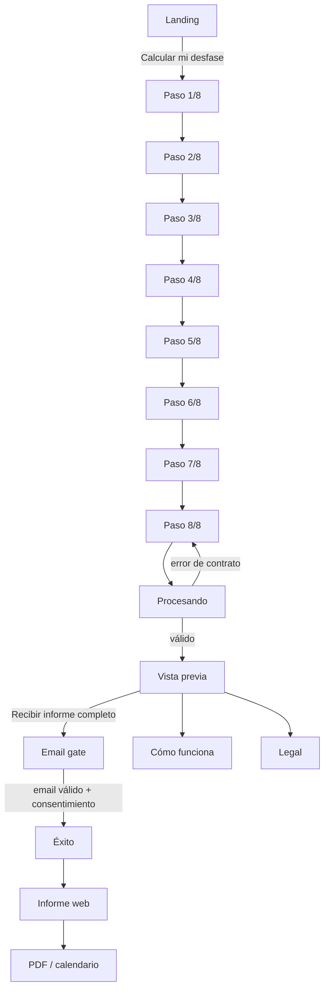
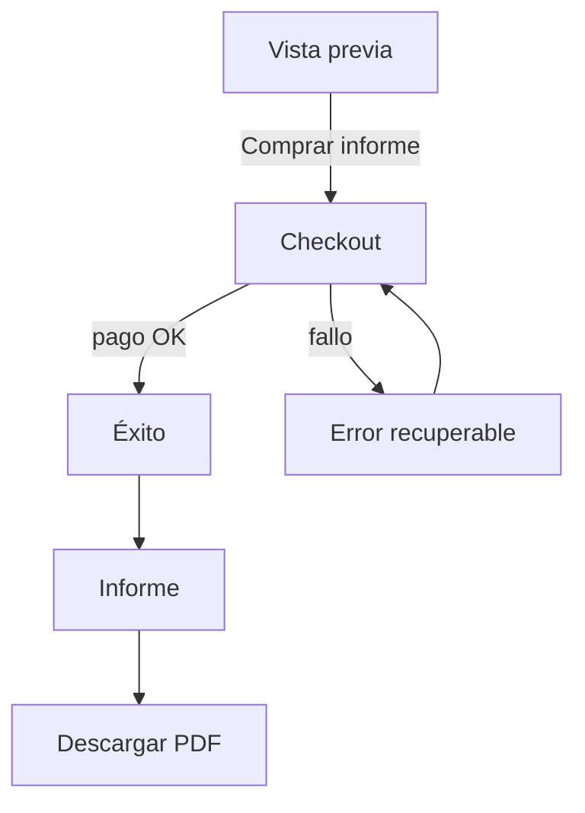
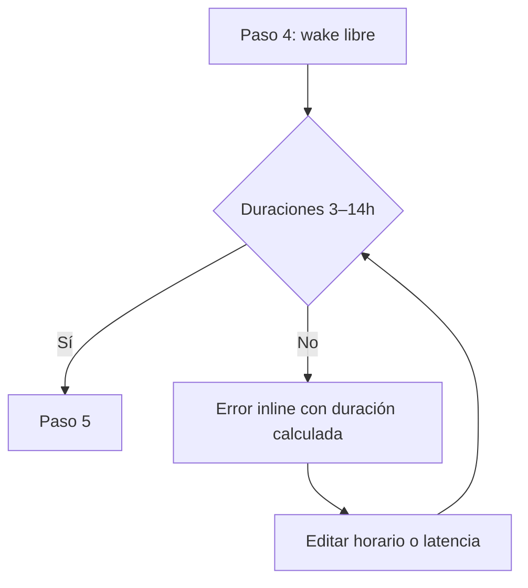
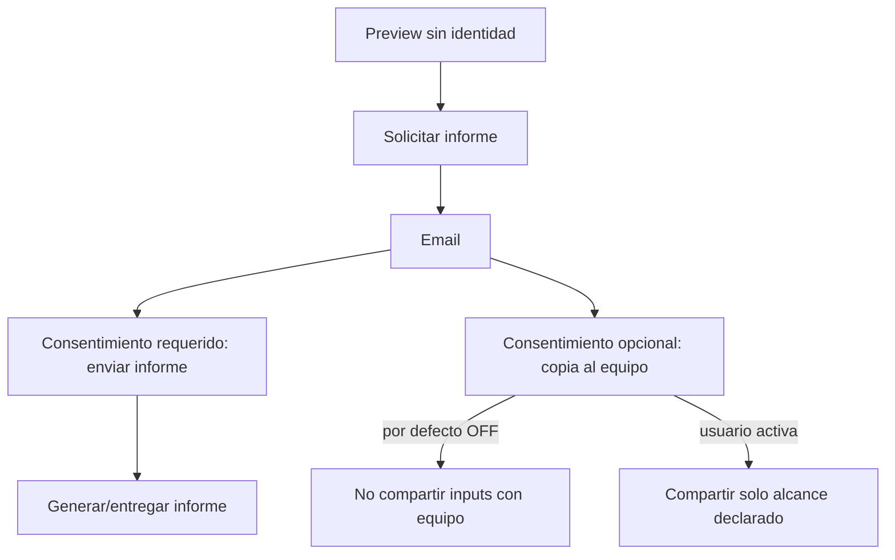

# ChronoSleep — Sitemap, rutas y flujos

## 1. Sitemap

```text
/
├─ /calcular/1 … /calcular/8
├─ /procesando
├─ /resultado
├─ /informe/solicitar          (fase 1)
├─ /checkout                   (fase 2, feature flag)
├─ /informe/listo
├─ /informe/:id
├─ /como-funciona
├─ /faq
├─ /legal/privacidad
├─ /legal/terminos
├─ /legal/salud
├─ /{locale}/...               (en, es, pt)
├─ /{locale}/{country}/social-jetlag
├─ /{locale}/{country}/casos/{use_case}
└─ /admin                      (auth, noindex)
```

## 2. Rutas canónicas

| Pantalla | Ruta | Indexación |
|---|---|---|
| Landing | `/` / `/{locale}` | index |
| Calculadora | `/calcular/:step` | noindex |
| Procesando | `/procesando` | noindex |
| Preview | `/resultado` | noindex |
| Solicitar informe | `/informe/solicitar` | noindex |
| Checkout | `/checkout` | noindex |
| Éxito | `/informe/listo` | noindex |
| Informe individual | `/informe/:id` | noindex + token/ACL |
| Cómo funciona | `/como-funciona` | index |
| FAQ | `/faq` | index |
| Legal | `/legal/*` | index según política |
| Admin | `/admin` | noindex, auth |

Los slugs públicos deben localizarse en implementación si el equipo lo decide; la tabla anterior usa nombres internos estables para evitar duplicar lógica.

## 3. Flujo principal — Fase 1



## 4. Flujo de pago — Fase 2



## 5. Flujo de error de horarios



## 6. Flujo de privacidad



## 7. SEO por país y caso de uso

La calculadora no necesita una landing distinta para cambiar el modelo; las páginas SEO sirven para intención y moneda, no para variar la lógica clínica.

### Países iniciales

- `/es/mx/social-jetlag`
- `/es/es/social-jetlag`
- `/pt/br/social-jetlag`
- `/en/us/social-jetlag`
- `/en/gb/social-jetlag`
- `/en/ca/social-jetlag`
- `/en/au/social-jetlag`

### Casos de uso

- `.../casos/trabajo-hibrido` / `hybrid-work` / `trabalho-hibrido`
- `.../casos/estudiantes-adultos` / `adult-students` / `estudantes-adultos`
- `.../casos/weekend-sleep-shift` con equivalente local
- `.../casos/cambio-de-horario-laboral`

**Excluir de SEO/MVP:** “tratamiento del insomnio”, “apnea”, “melatonina”, “jet lag de viajes”, “turnos nocturnos/rotativos” y páginas que impliquen diagnóstico o tratamiento.

### Reglas SEO

- Canonical por combinación idioma/país.
- `hreflang` entre ES/EN/PT.
- Contenido del país solo cambia moneda, ejemplos y contexto cultural; no inventar prevalencias locales sin fuente.
- Structured data permitido: `WebApplication` y `FAQPage` si el contenido visible cumple las políticas del buscador.
- No indexar resultados individuales ni estados del funnel.
- El title debe describir calculadora de social jetlag, no “test médico” ni “diagnóstico”.

## 8. Navegación global

Header público: logo → Cómo funciona → FAQ → selector de idioma → CTA “Calcular”. En pantallas del funnel, reducir navegación a logo + idioma + ayuda para evitar salida accidental. Footer: metodología, privacidad, términos, disclaimer de salud y versión del modelo.

## 9. Estados de sesión

- `anonymous_calculation`: inputs en memoria/local storage con expiración definida por PRD.
- `preview_ready`: resultado disponible sin identidad.
- `report_requested`: email y consentimiento registrados.
- `payment_pending` / `paid`: solo fase 2.
- `report_ready`: informe asociado a ID opaco.
- Nunca usar email o horarios en URL/query string.
